# DGM Mathematical Formulation & Architecture

The **DeltaGraphModel (DGM)** generative pipeline executes seven sequential computational steps to synthesize realistic, hydraulically consistent delta channel networks (DCNs):

```mermaid
flowchart TD
  classDef startNode fill:#121612,stroke:#ff5a35,stroke-width:2px,color:#ffffff;
  classDef stepNode fill:#0c0e0c,stroke:#3a443a,stroke-width:1px,color:#ffffff;
  classDef accentNode fill:#141b14,stroke:#c4f94a,stroke-width:1.5px,color:#ffffff;

  Inputs["<b>INPUTS</b><br/>Node Budget N, Forcing Ratio R_rt ∈ (0, 1), YAML Config"]:::startNode

  Step1["<b>STEP 1: Polar Domain & Valley Confinement</b><br/>Fan angle θ_open = (θ_base + Δθ · R_rt) · (1 - C_conf)<br/>Valley Bounds: |x| ≤ W_valley / 2"]:::stepNode

  Step2["<b>STEP 2: Polar Tree Backbone Growth</b><br/>Radial Stepping Δr(r) & Sinuosity S(r)<br/>Jordan Curve Planarity Filter (0 Edge Crossings via 2D AABB)"]:::stepNode

  Step3["<b>STEP 3: Emergent Loop Engines</b><br/>Mechanism A: Spatial Potential-Field Reconnection<br/>Mechanism B: Thermodynamic nER Annealing"]:::accentNode

  Step4["<b>STEP 4: Pre-Hydraulic Pruning & Simplification</b><br/>Inland Dead-End Spur Removal (100% Shoreline Delivery)<br/>Degree-2 Chain Contraction & Sinuosity Recalculation"]:::stepNode

  Step5["<b>STEP 5: Emergent Hydraulics & Murray's Law</b><br/>Murray Capacity Conservation: w_0^p = w_1^p + w_2^p<br/>Estuarine Tidal Flaring & Manning Conductance C_e"]:::stepNode

  Step6["<b>STEP 6: Curved Polyline Channel Geometry</b><br/>Harmonic Dirichlet Meander Centerlines<br/>Analytical Proximity Amplitude Clearance A_max"]:::stepNode

  Step7["<b>STEP 7: Markov Flux Routing & Metrics Battery</b><br/>Transient Submatrix Solver: (I - Q^T) Φ_T = S_0,T<br/>20-Metric Geomorphic Battery (α, β_1/N, nER, eBI, V_net)"]:::startNode

  Inputs --> Step1 --> Step2 --> Step3 --> Step4 --> Step5 --> Step6 --> Step7
```

---

## Step 1: Polar Domain Geometry & Valley Confinement

The delta apex is positioned at origin $(r=0, \theta=0)$. The marine shoreline boundary is located at radius $r = R_{\text{shore}}$ (default $10,000 \text{ m}$). Marine hydrodynamic energy expands active sectoral fan spreading, while valley confinement narrows it:

$$\theta_{\text{open}}(R_{\text{rt}}, C_{\text{conf}}) = (\theta_{\text{base}} + \Delta \theta \cdot R_{\text{rt}}) \cdot (1 - C_{\text{conf}})$$

Lateral valley corridor boundaries clamp Cartesian coordinate excursions:
$$\vert x(r) \vert \le \frac{W_{\text{valley}}}{2}$$

---

## Step 2: Polar Tree Backbone Growth & Shoreward Spatial Scaling

A directed branching tree is grown outwards from apex. Branching order $k \in \{1, 2, 3\}$ is sampled stochastically according to `branching_weights`.

- **Shoreward Node Contraction**: Inter-junction distance contracts as channels approach the sea:
  $$\Delta r(r) = \Delta r_0 \cdot \max(0.2, 1 - \lambda_{\text{node}} \cdot r / r_{\text{shore}})$$
- **Coastal Sinuosity Straightening**: Distributaries straighten in the seaward reach:
  $$S(r) = \max\left(1.0, 1.0 + (S_0 - 1.0) \cdot \max\left(0, 1 - \lambda_{\text{sin}} \cdot \frac{r_{\text{mid}}}{r_{\text{shore}}}\right)\right)$$

Planarity is strictly preserved using 2D Axis-Aligned Bounding Box (AABB) fast rejection combined with the Jordan Curve orientation predicate, guaranteeing 0 unphysical edge crossings.

---

## Step 3: Emergent Loop Engines

### Mechanism A: Spatial Potential-Field Reconnection
Evaluates candidate pairs $(u, v)$ via KDTree nearest-neighbor queries:
$$P_{\text{loop}}(u, v \mid R_{\text{rt}}) = \min(0.95, (P_0 + c_0 R_{\text{rt}}) \cdot e^{-d(u,v)/l_0} \cdot \max(0, \cos(\Delta \theta_{uv})))$$

Links are added under strict planarity and degree bounds ($k_{\text{in}} \le 2, k_{\text{out}} \le 3$). Maximum allowable loops scale with marine forcing:
$$N_{\text{loops}}^{\max} = \lfloor N \cdot (\text{slope} \cdot R_{\text{rt}} + \text{intercept}) \rfloor$$

### Mechanism B: Thermodynamic nER* Optimality
Constructs a candidate network and optimizes link configuration using Simulated Annealing to maximize Non-Local Shannon Entropy Rate ($nER^*$) under a total channel count budget.

---

## Step 4: Pre-Hydraulic Network Pruning & Simplification

- **Inland Dead-End Pruning & Coastal Protection**: Cascades through leaf nodes terminating inland without reaching the shoreline envelope:
  $$r < r_{\text{shore}} \cdot (1 - \epsilon_{\text{shore}})$$
  where $\epsilon_{\text{shore}} = \text{outlet_tolerance}$ (default $0.05$). This accommodates coastal rugosity while guaranteeing 100% shoreline outlet delivery matching DIDNT observations.
- **Degree-2 Reach Simplification**: Contracts non-branching pass-through chains ($d_{\text{in}}=1, d_{\text{out}}=1$) into direct links between morphological junctions. When `recalculate_reach_sinuosity=True`, a unified reach sinuosity is drawn from the lognormal process model rather than compounding discrete knees, matching RivGraph and DIDNT reach-scale standards. Continuous polyline coordinates are preserved across merged vertices.

---

## Step 5: Emergent Hydraulics & Murray's Law Conservation

Channel widths are solved using an iterative topological relaxation solver conserving Murray's Law at all bifurcations:
$$w_{\text{parent}}^p = w_{\text{child1}}^p + w_{\text{child2}}^p + \dots$$
where exponent $p \in [1.2, 2.2]$ (default $1.85$).

### Estuarine Tidal Mouth Flaring
Tidal prism amplification widens distributary mouths seaward of an onset radius ($r_{\text{onset}} = \text{tidal_flare_onset}$, default $0.30$):
$$w(r) = w_{\text{river}} \cdot \left((1 - R_{\text{rt}}) + R_{\text{rt}} \exp\left(k_{\text{flare}} \cdot \max\left(0, \frac{r}{r_{\text{shore}}} - r_{\text{onset}}\right)\right)\right)$$

### Secondary Loop Resistance Penalty
To capture narrower cross-sections ($36\%-60\%$ of branch width) and higher floodplain bed elevations in anastomosing cross-ties (Gao et al. 2023), loop conductances are scaled by `loop_flow_penalty` (default $0.40$):
$$C_{\text{loop}} = C_e \times \text{loop_flow_penalty}$$

Manning conductance scales as $C_e = w_e^\eta / L_e^\gamma$ (default $\eta = 1.65, \gamma = 0.50$).

---

## Step 6: Curved Polyline Channel Geometry & Proximity Constraints

Meander amplitudes are constrained by lateral proximity to non-incident channels:
$$A_{\max} = \max(0.0, d_{\text{clearance}} \cdot C_{\text{clear}})$$
$$S_{\max} = 1.0 + \left(\frac{\pi A_{\max}}{L}\right)^2$$

Centerline trajectories are generated via harmonic sine curves satisfying Dirichlet boundary conditions (zero displacement at nodes):
$$y(s) = A \cdot \sin(2\pi \cdot \text{bends} \cdot s) \cdot \sin(\pi s)$$

When curved centerlines update reach length, hydraulic conductance $C_e = w^\eta / L^\gamma$ is automatically re-synchronized.

---

## Step 7: Markov Flux Routing Solver & Metrics Battery

Steady-state water fluxes are solved via the transient submatrix formulation (Tejedor et al., 2017):
$$(I - Q^T) \Phi_T = S_{0,T}$$
$$\Phi_A = S_{0,A} + W_{TA}^T \Phi_T$$

The 20-metric geomorphic battery computes:
- **Topological form**: $\alpha$, $\beta_1/N$, $V_b$, $V_c$, $V_c/V_b$, $\Gamma$.
- **Entropy & Braiding**: $nER^*$, $eBI$.
- **Energetic dissipation**: Total dissipation $D_{\text{net}}$, variance dissipation.
- **Dynamic vulnerability**: Global vulnerability $V_{\text{net}}$, max channel vulnerability.
- **Hydraulic geometry**: Mean width, width CV, mean reach sinuosity, shoreline delivery ratio.

---

## Multi-Stage Generative Pipeline Inspection

When `dgm.generate(..., return_stages=True)` is called, DGM captures and returns snapshots at key pipeline milestones:
1. `'tree'`: Polar tree backbone before loop closure.
2. `'looped'`: Network after spatial potential-field loop addition.
3. `'pruned'`: Simplified and pruned network before hydraulics.
4. `'final'`: Complete network with Murray widths, sinuous polylines, and Markov fluxes.

These snapshots can be directly rendered side-by-side using `dgm.plot_stages` or `dgm.plot_tree_vs_network`.
